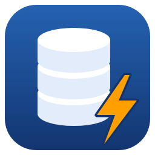
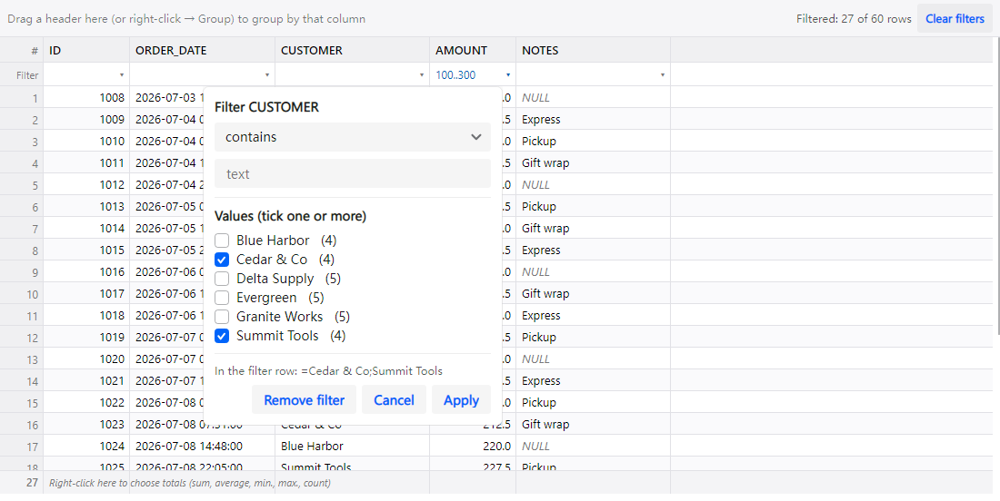
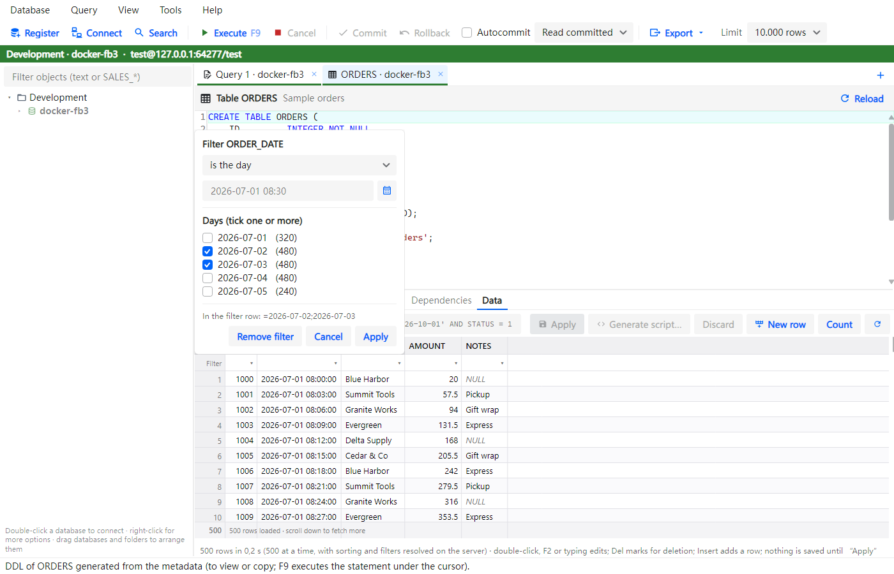
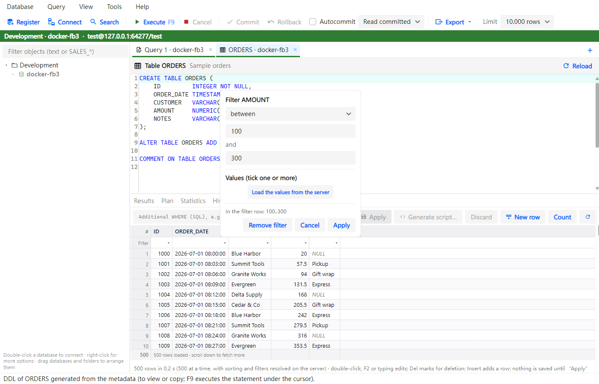
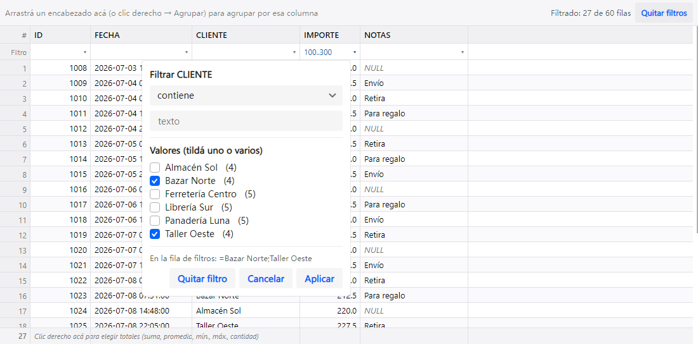
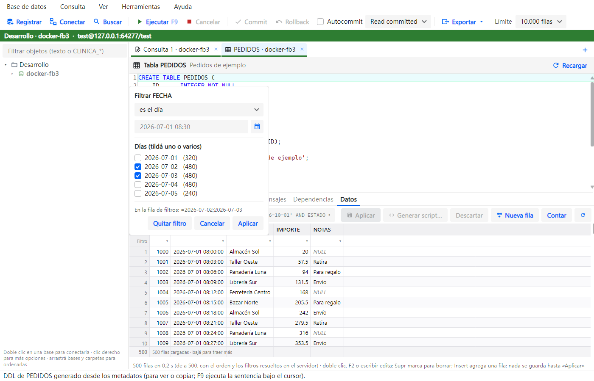
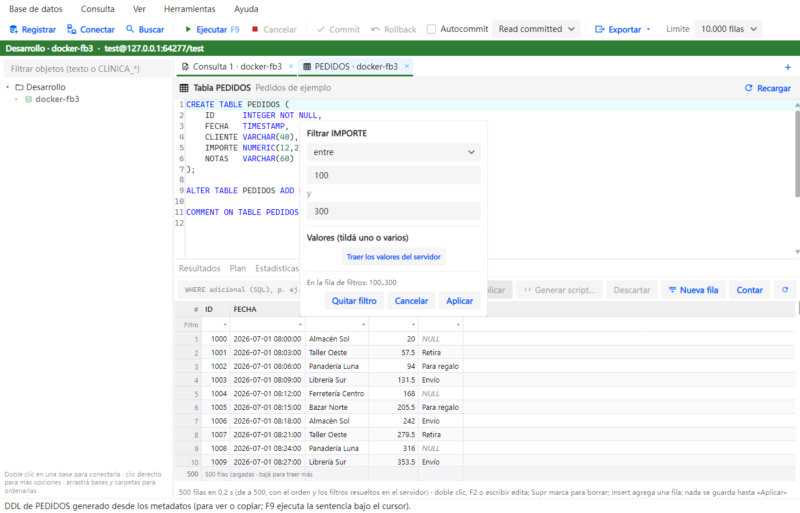

<p align="center">
  
</p>

<h1 align="center">FbStudio</h1>

<p align="center">
  A free IDE and administration tool for <b>Firebird</b> databases, written from scratch in .NET 10 and Avalonia.
  <br>
  <i>IDE y herramienta de administración para Firebird, libre y gratis — <a href="#en-español">en español, abajo</a>.</i>
</p>

<p align="center">
  
  
  
  
  
</p>

<p align="center">
  <a href="#features">Features</a> ·
  <a href="#download">Download</a> ·
  <a href="#build-from-source">Build from source</a> ·
  <a href="#linux-and-macos">Linux and macOS</a> ·
  <a href="#bugs-ideas-and-contributions">Bugs and ideas</a> ·
  <a href="#license">License</a> ·
  <a href="#en-español">Español</a>
</p>



## Why

FbStudio is built for day-to-day work with Firebird: writing and running SQL, browsing and editing data, watching
transactions, comparing databases and taking backups, with extra care for **production** databases. It aims to feel
familiar to people coming from commercial tools, without licenses or subscriptions.

## Features

- **SQL editor** with highlighting, autocompletion (tables, columns, also of subqueries and WITH, procedures,
  functions, packages, generators, with parameter help), F9 to run the selection or the
  whole script (understands `SET TERM` and PSQL blocks), parameters (`?` and `:name`, asked for before running),
  explicit transactions (Commit / Rollback) and cancellation; a SQL formatter, Ctrl+click (or F12) on a name to open
  the object, and templates (abbreviation + Tab, or Ctrl+J).
- **Production safety:** every database has an environment (Development, Test, Production, each with its own color),
  read-only registrations, and a confirmation before an UPDATE or DELETE without WHERE or any change in production.
- **A fast grid** (hand-drawn: it does not choke on a million rows) with sorting, typed column filters (text, numbers,
  dates with periods such as "this month", values to tick), grouping, totals, columns you reorder by dragging, and copy
  as text, INSERT or UPDATE.
- **Table and view data** in pages, with filters and sorting on the server, and editing that never holds row locks:
  changes are applied together (all or nothing).
- **Registrations backup:** export them (with or without user names, and with passwords encrypted with a passphrase)
  and import them on another computer, Linux or macOS included.
- **Objects:** database tree with your own folders, DDL of every object, compile procedures, triggers and views,
  dependencies, and search across all metadata.
- **Areas** to find your way in a big database: your own groups of objects, by name patterns such as `LAB_*` or by
  hand (an object can be in several, and triggers and indexes go with their table), plus the procedures, views and
  triggers that use only the area's tables, suggested from the table prefixes. They show up in the tree and filter the
  metadata search, and they live in a file per database that the whole team can share.
- **Diagrams** of a table and its neighbors or of an area: foreign keys and the "logical" ones written in column
  comments (dashed), heavily referenced tables hidden until you ask for them, automatic layout (MSAGL), drag and zoom,
  and export to PNG, SVG or an editable draw.io file.
- **Monitoring** of connections, transactions (OAT) and locks, with custom queries you can share; kill a connection or
  cancel a statement.
- **Server details:** version, architecture detected on connect (Classic, SuperClassic or SuperServer), operating
  system and cache, without showing server paths.
- **Trace:** the statements from any program that take longer than a threshold, live, with an **analysis by query**
  (the same statements together, sorted by total time, with reads, writes, plan and full scans); it also opens saved
  trace logs.
- **Statistics** (header and full, in grids) without installing gstat, of the whole database or only the tables you
  choose, and **compared** with another database side by side.
- **Full database script** and **database compare** with the script to make them equal.
- **Maintenance:** backup, restore, empty database from the script (copying the tables you choose), online validation
  and sweep, all running on the server, with gbak's rescue options (ignore checksums, restore without NOT NULL, skip
  the data of chosen tables) and validation of chosen tables; database properties (sweep interval, forced writes,
  read-only, cache); a warning if a database was left in nbackup backup mode, and its nbackup history.
- **Export** to CSV for Excel, Excel (.xlsx) or an INSERT script, including the whole result without loading it in
  memory.
- **Import** a CSV or Excel (.xlsx) file into a table: columns matched by name, a preview, and everything in one
  transaction (a failing row undoes it all, or is skipped and listed).
- **Users and permissions:** server users, database roles and grants with checkboxes per object; the GRANT/REVOKE
  script is shown before applying it all in one transaction, and passwords are never displayed.
- **English and Spanish** interface, light and dark mode.

| | |
|---|---|
|  |  |

## Status

**Preview.** Used every day against **Firebird 3.0** on **Windows**, and tried on **Linux** (Ubuntu). On **macOS** it
starts on GitHub's Macs but has not been tried on a real Mac yet.

## Download

Ready-to-run packages are on the [Releases](https://github.com/diegodelafuenteDim/FbStudio/releases/latest) page.
Nothing else to install: no .NET and no Firebird client (FbStudio talks to the server directly).

| System | File | How to install |
|---|---|---|
| Windows 10 or 11 (64-bit) | `FbStudio-<version>-win-x64.zip` | Extract it and run `FbStudio.exe`. It is not signed, so the first time Windows may show "Windows protected your PC": click **More info** → **Run anyway**. |
| Debian, Ubuntu and derivatives | `fbstudio_amd64.deb` | `sudo apt install ./fbstudio_amd64.deb`, then open it from the menu or run `fbstudio`. |
| Other Linux distributions | `FbStudio-<version>-linux-x64.tar.gz` | Extract it and run `./FbStudio`. Install `libsecret-tools` so it can remember passwords. |
| macOS, Apple Silicon (M1 and later) | `FbStudio-<version>-osx-arm64.zip` | Extract it and open `FbStudio.app`. It is not signed by Apple, so the first time macOS blocks it: System Settings → Privacy & Security → **Open Anyway** (or, in Terminal, `xattr -dr com.apple.quarantine FbStudio.app`). |
| macOS, Intel | `FbStudio-<version>-osx-x64.zip` | The same as above. |

`https://github.com/diegodelafuenteDim/FbStudio/releases/latest/download/fbstudio_amd64.deb` is always the latest
`.deb`. What changed in each version: [CHANGELOG.md](CHANGELOG.md) (also in FbStudio, Help → What's new). To check a download, compare it with `SHA256SUMS.txt` from the same release
(`sha256sum -c SHA256SUMS.txt --ignore-missing`).

## Build from source

You need the **.NET 10 SDK** ([download](https://dotnet.microsoft.com/download)).

```bash
git clone https://github.com/diegodelafuenteDim/FbStudio.git
cd FbStudio
dotnet run --project src/FbStudio.App
```

The integration and UI tests start a Firebird 3 server in **Docker** (Testcontainers), so Docker must be running. Tests
**never** touch real servers.

```bash
dotnet test
```

## Linux and macOS

FbStudio is cross-platform (Avalonia). Passwords go to each system's keychain:

| System | Where passwords are kept | What you need |
|---|---|---|
| Windows | DPAPI (only your user on that PC can read them) | nothing |
| Linux | The desktop keyring (GNOME Keyring, KWallet…) | `libsecret-tools` (the `secret-tool` command) |
| macOS | The user's Keychain | nothing |

Without a keyring (for example, a Linux machine with no desktop), passwords are remembered only while FbStudio is open
and the query history is not saved; they are **never** written in plain text. The history is encrypted with DPAPI on
Windows and with AES on Linux and macOS (with a random key kept in the keyring).

**The packages** ([Download](#download)) are built by GitHub Actions for each version tag, and also on request
(*Actions* tab → *CI* → *Run workflow*, kept in the run for 7 days); the Mac ones are built and signed (ad hoc) on a
Mac. You can also build them yourself (the Mac packages, on a Mac):

```bash
tools/publish/publish.sh
```

**Trying the Linux build on Windows 11:** WSL2 includes WSLg, which runs Linux desktop apps. `wsl --install -d Ubuntu`,
then inside Ubuntu `sudo apt install libsecret-tools gnome-keyring` and run `./FbStudio`.

## How it is built

```
src/
  FbStudio.Core        no UI and no Firebird: SQL (lexer, script splitter, autocompletion), metadata and DDL,
                       result filters and views, exporters, database compare
  FbStudio.Firebird    FirebirdClient: query sessions, metadata explorer, monitoring, services (backup…)
  FbStudio.Workspace   database registrations, encrypted passwords and history, settings
  FbStudio.App         Avalonia: main window, tabs, custom grid (DrawnGrid)
tests/                 unit, integration with Firebird in Docker, headless UI
tools/                 publish script, icon generator
```

FbStudio is an original work, designed from Firebird's public documentation. It contains no code, files or resources
from any other product.

## Bugs, ideas and contributions

- **Found a bug?** Open a [bug report](https://github.com/diegodelafuenteDim/FbStudio/issues/new?template=bug_report.yml).
- **Want a feature?** Open a [feature request](https://github.com/diegodelafuenteDim/FbStudio/issues/new?template=feature_request.yml).
- **A question or an idea to discuss?** Use [Discussions](https://github.com/diegodelafuenteDim/FbStudio/discussions).
- **Want to contribute code?** Read [CONTRIBUTING.md](CONTRIBUTING.md).
- **A security problem?** Please don't post it publicly: follow [SECURITY.md](SECURITY.md).

Issues and discussions are welcome in English or Spanish. FbStudio is free and will stay free: a ⭐, bug reports and
telling us how you use it help a lot.

## License

[Apache 2.0 with the Commons Clause condition](LICENSE). In plain words:

- ✅ You may **use it for free**, also at your company, **modify it** and **share it**.
- ❌ You may **not sell it**, or charge for a product or service whose value is essentially FbStudio.

Because of that condition it is not "open source" under the OSI definition: it is source-available and free to use.
Third-party components keep their own licenses: [THIRD-PARTY-NOTICES.md](THIRD-PARTY-NOTICES.md).

FbStudio is not affiliated with the Firebird Foundation. "Firebird" is a trademark of the Firebird Foundation and is
named for reference only.

---

## En español

**FbStudio** es un IDE y herramienta de administración para bases **Firebird**, libre y gratis, hecho desde cero en
.NET 10 y Avalonia, con la interfaz en español y en inglés. Incluye:

- editor de SQL con autocompletado, formateador, Ctrl+clic para abrir un objeto y plantillas;
- seguridad para producción (entornos, registros de solo lectura, confirmaciones);
- una grilla rápida con filtros según el tipo de columna y columnas que se reordenan arrastrando;
- edición de datos sin dejar registros bloqueados;
- áreas propias para ordenar una base grande (por prefijo o a mano, un objeto en varias, con los procedimientos que
  usan solo sus tablas), en el árbol y en la búsqueda, guardadas en un archivo por base que se puede compartir;
- diagramas de una tabla y sus vecinas o de un área (con las FK lógicas de los comentarios), exportables a PNG, SVG y
  draw.io;
- monitoreo (OAT, bloqueos), trace con análisis por consulta y estadísticas (de toda la base o de las tablas que se
  elijan, y comparadas con otra base);
- datos del servidor: versión, tipo (Classic, SuperClassic o SuperServer) y sistema;
- backup de los registros de conexión (con las contraseñas cifradas con una frase) para pasarlos a otro equipo;
- script de la base entera y comparación de bases;
- backup, restore, validación, sweep y propiedades de la base;
- usuarios, roles y permisos (con el SQL a la vista antes de aplicarlo);
- exportación a CSV, Excel y script INSERT, e importación de un CSV o un Excel a una tabla.



| | |
|---|---|
|  |  |

Además:

- **Estado:** versión preliminar. Se usa todos los días contra Firebird 3.0 en Windows y se probó en Linux (Ubuntu); en
  macOS arranca en las Mac de GitHub, pero todavía no se probó en una Mac real.
- **Descargar:** en [Releases](https://github.com/diegodelafuenteDim/FbStudio/releases/latest), sin instalar nada más
  (ni .NET ni el cliente de Firebird):
  - **Windows:** el `.zip`; se descomprime y se abre `FbStudio.exe`. No está firmado, así que la primera vez Windows
    puede mostrar «Windows protegió su PC»: **Más información** → **Ejecutar de todas formas**.
  - **Debian y Ubuntu:** `sudo apt install ./fbstudio_amd64.deb`, y queda en el menú y como comando `fbstudio`.
  - **Otras distribuciones de Linux:** el `.tar.gz`; se descomprime y se corre `./FbStudio` (con `libsecret-tools`
    para que recuerde las contraseñas).
  - **macOS:** el `.zip` de tu Mac (`osx-arm64` para Apple Silicon, `osx-x64` para Intel). La primera vez:
    Configuración del Sistema → Privacidad y seguridad → **Abrir igualmente**.
- **Qué cambió en cada versión:** [CHANGELOG.md](CHANGELOG.md), también en FbStudio, en Ayuda → Novedades.
- **Compilarlo:** con el SDK de .NET 10, `dotnet run --project src/FbStudio.App`. Los tests necesitan Docker.
- **Contraseñas:** van al llavero de cada sistema: DPAPI en Windows, `secret-tool` en Linux y el Llavero en macOS.
- **Errores y pedidos:** en los formularios de *Issues* (en español o en inglés). Para dudas e ideas, *Discussions*.
- **Licencia:** Apache 2.0 con la condición «Commons Clause». Lo podés usar gratis (también en tu empresa), modificar y
  compartir, pero **no vender**.
- FbStudio no está afiliado a la Firebird Foundation.
